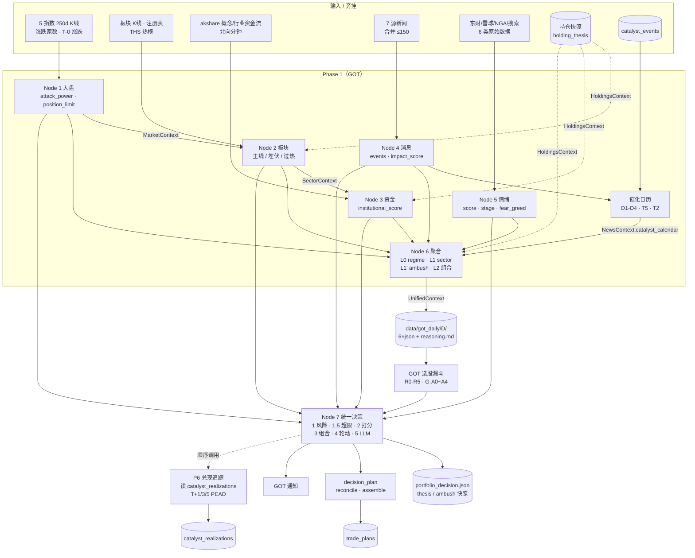
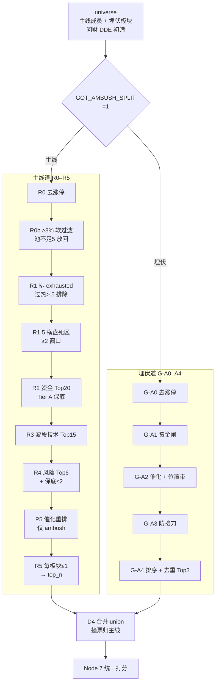

# GOT 全链路流程图（代码实证版）

> **口径**：2026-10-28 直读 `src/got/` + `src/services/` 代码；`docs/got/architecture.md` 正文为 0831 快照，本文以**代码**为准，二者冲突处在 §13 单列。
> **入口**：`python main.py --got`（生产）；`--got-replay` 只跑回放变体，不产生持久化副作用。
> **读图**：实线=数据流；虚线=旁挂/持仓供数；方框=节点；圆柱=持久化。

---

## 1. 主流程图

> 主图约 2035px 宽；Markdown 预览若按容器宽压缩，建议点击放大查看。

---

## 2. 编排顺序与失败边界

| 序 | 动作 | 条件 | 失败行为 | 出处 |
|---|---|---|---|---|
| 0 | 交易日检查 | `use_mock=False` | `NonTradingDayError`，退出码 0 | `orchestrator.py:127` |
| 0b | `bar_complete` 计算 | 全流程一次 | 透传 Node 4 / Phase 2 | `orchestrator.py:143` |
| 0c | 网络预检 | `GOT_NET_PREFLIGHT` | 仅观测，不降级 | `orchestrator.py:152` |
| 0d | `HoldingsContext` | 生产 | fail-open → 按无持仓运行 | `orchestrator.py:170` |
| 1 | Node 1→2→3 串行 | 技术路 | 任一异常 → 整轮 raise | `orchestrator.py:174` |
| 2 | Node 4 ‖ Node 5 | 数据路 | 任一异常 → 整轮 raise | 同上 |
| 2.5 | 市场结构 4b | 影子默认开 | 失败忽略，回退 unknown | `orchestrator.py:193` |
| 3 | Node 6 | 汇合 | 主链异常向上抛 | `orchestrator.py:208` |
| 4 | `archive_daily_run` | 生产 | 失败不阻断 | `orchestrator.py:225` |
| 5 | Node 7 | 生产 | 失败写 `status=failed` 占位产物 | `orchestrator.py:268` |
| 6 | `archive_phase2` | 生产 | 失败仅记日志 | `orchestrator.py:289` |
| 7 | P6 兑现 | 生产 | 失败不阻断 | `orchestrator.py:335` |
| 8 | GOT 通知 | `GOT_NOTIFY_ENABLED=1`（缺省） | 失败不阻断 | `main.py:1674` |

`use_mock=True` 时只跑节点 mock 输出，不归档、不跑 Phase 2。

---

## 3. Node 1 大盘

**输入**：5 指数 250 日 K 线（创业板 0.6 + 科创 50 0.4；中证 500；沪深 300；上证仅展示）、涨跌家数、腾讯 T-0 涨跌幅。
**输出**：`MarketContext`。

### 3.1 数据结构

| 模型 | 关键字段 | 说明 |
|---|---|---|
| `MarketContext` | `tech_growth`, `market_state`, `mid_small_cap`, `large_cap`, `position_limit`, `confidence`, `key_levels`, `today_change`, `market_breadth`, `realized_volatility`, `vol_adjusted_position`, `regime_scale`, `data_quality` | 根节点输出 |
| `TechGrowthSignal` | `trend`, `score(-1..1)`, `constituents{chinext,star50}`, `consistency`, `signals{short/medium/long}`, `timeframe_got`, `regime_metadata` | 科技成长主信号 |
| `TimeframeGOTResult` | `unified_trend`, `unified_score`, `contradiction_type`, `timeframe_confidence` | 5/20/60 日 mini-GOT |
| `MarketStateSignal` | `attack_power(0..1)`, `regime`, `mini_got_*`, `timeframe_consistency`, `contradiction_type`, `risk_state`, `realized_volatility`, `crash_override` | 下游主消费量 |
| `StyleSignal` | `trend`, `score`, `signals` | 中证 500 / 沪深 300 |

### 3.2 算法与门阈

| 环节 | 规则 | 数值 | 出处 |
|---|---|---|---|
| ADX 分档权重 | 强趋势（ADX>30） | MA .24 / MACD .35 / 量价 .29 / 布林 .12 | `indicators.py:257` |
| | 温和（20–30） | .29 / .29 / .24 / .18 | `indicators.py:265` |
| | 震荡（≤20） | .12 / .24 / .24 / .40 | `indicators.py:273` |
| 趋势判定 | `score` 阈值 | ±0.3 | `market_analysis.py:373` |
| 时间框架合成 | short / medium / long | .20 / .35 / .45 | `market_analysis.py:469` |
| 短长背离 | `abs(short-long)>0.3` | 记 `short_vs_long` | `market_analysis.py:455` |
| 短中冗余 | `abs(short-medium)<0.05` | 记冗余 | `market_analysis.py:460` |
| 置信度 | 跨指数 .35 + 跨框架 .35 + ADX/40×.30 | clip [.05, 1] | `market_analysis.py:715` |
| T-0 反向修正 | 技术方向 ≠ 当日方向 | confidence ×.7；同向 ×1.1 | `market_analysis.py:775` |
| 波动率目标 | 20 日年化波动；`target_vol/realized_vol` | target .15；clip [.5, 1.5] | `market_analysis.py:550` |
| 状态缩放 | 框架 .40 + 跨指数 .30 + 方向 .30 | clip [.2, 1.0] | `market_analysis.py:600` |
| 仓位上限 | L1 × L2 | clip [.2, 1.5] | `market_analysis.py:650` |
| attack_power | `.5×(0.5×动量+0.5×mini) + .5×风险` | 风险 = `(pos-.2)/1.3` | `market_analysis.py:240` |
| 暴跌 override | 最弱指数单日 < -3% | `attack_power ≤ .15` | `market_analysis.py:248` |
| 风险状态 | 年化波动 | >.45 extreme；>.30 high | `market_analysis.py:256` |
| 节点 regime | bullish 且 ap>.6 → bull；bearish 或暴跌且 ap<.3 → bear | 其余 transition | `market_analysis.py:262` |

**LLM**：1 次，temp .3，max_tokens 200，仅生成 100 字摘要，不参与信号。

**降级**：指数 K 线缺失进入 `missing_fields` / `fetch_failed_fields`；技术指标失败跳过该指数；无任何指数 → raise。

---

## 4. Node 2 板块

**输入**：`MarketContext`（`attack_power` 约束主线数量、`today_change` 弱市判断）；板块 K 线、注册表、THS 热榜。
**输出**：`SectorContext`。

### 4.1 数据结构

| 模型 | 关键字段 |
|---|---|
| `SectorContext` | `active_mainline[]`, `exhausted_mainline[]`, `ambush[]`, `near_miss_ambush[]`, `defensive_rotation[]`, `cooling_down[]`, `top_by_score[]`, `industry_top[]`, `theme_families[]`, `market_direction`, `strength_lookup{}`, `overheat_lookup{}`, `crowded_families[]`, `frame_group_lookup{}`, `ths_hot_sectors{}`, `holdings_sectors[]`, `holdings_coverage`, `confidence_level`, `status` |
| `SectorDetail` | `code`, `name`, `state`, `strength_score(0..100)`, `indicators{}`, `lifecycle{phase,days_since_launch}`, `tier`, `mainline_quality`, `mainline_days`, `wave_days`, `strength_trajectory[]`, `rrg{rs_ratio,rs_momentum,quadrant}`, `overheat_severity`, `momentum_state`, `rs_mom_decay_2d`, `exit_pressure_days`, `near_miss_conditions[]`, `break_signals{}` |
| `MainlineGroup` | `group_name`, `group_score`, `tier`, `mainline_quality`, `members[]` |
| `ThemeFamily` | `family_name`, `family_score`, `family_resonance`, `theme_status`, `member_boards[]`, `mixed_driver` |

### 4.2 强度评分（4 维截面百分位）

| 维度 | 权重 | 原始指标 |
|---|---|---|
| 价格动量 | .30 | 5 日涨幅 |
| 换手扩张 | .25 | 5d 均量 / 20d 均量 |
| 相对强度 | .25 | 20 日涨幅 |
| 宽度健康 | .20 | 上涨家数 / 总家数 |

`strength = Σ(百分位 × 权重) × 100`。THS 热度加成：热度 ≥100k +5；≥60k +3；>0 +1；上限 100（`sector_analysis.py:1538`）。

RRG：`rs_ratio` / `rs_momentum` 各做 3 日 EMA（α=.5）；象限阈值 .5/.5（`sector_analysis.py:1861`）。

### 4.3 状态机（RRG 驱动，Markov 规则版）

| 场景 | 规则 | 出处 |
|---|---|---|
| 冷启动/neutral 入主线 | S/A：`score>60`；B：`score≥80`；且未破位、quadrant=leading | `sector_analysis.py:2500` |
| 破位 | 5日涨幅≤0 或 跌破 MA20 或（过热 exhausted 且 20 日高位<.60）或 单日分跌≥20 | 同上 |
| HI2 硬触发 | 单日 >8% + leading + score>70 → 当日进主线 | 同上 |
| 单日暴跌 | < -4% 且趋势破坏 → 当日 exhausted；仅暴跌 → cooling | 同上 |
| 退出压力 | score<50 +1/日；T-0 < -3% +2；< -1.5% +1 | `sector_analysis.py:2654` |
| 驱逐容忍 | S/A 3 日；B 1 日 | `sector_analysis.py:2530` |
| 降温修复 | leading/improving + score>55 + 5日涨幅>0 + dwell≥2 | 同上 |
| 降温熄灭 | score<45 → neutral | 同上 |
| 衰竭修复 | leading + score>60 + 当日涨 + dwell≥2 | 同上 |
| 衰竭熄灭 | 崩≥20 / score<50 / 破位，且 dwell≥3 → neutral | 同上 |
| 埋伏飞刀驱逐 | `rs_momentum<.2` 且 `score<25` → neutral | 同上 |
| 埋伏上位 | 不再满足埋伏 + leading + score>60 + dwell≥1 | 同上 |

生命周期：`leading→acceleration`，`improving→launch`，`weakening→mature`，`lagging→late_stage`（`sector_analysis.py:3290`）。

### 4.4 主线分级与数量

| 项 | 规则 |
|---|---|
| tier 加分 | 国家级政策链 +3；非“其他”家族 +1；换手百分位 >.6 +2、>.4 +1；动量&相对强度均 >.6 +1 |
| tier | S≥5，A≥3，B<3 |
| 主线数量 | attack_power：<.15→1；<.30→2；<.50→3；<.70→4；≥.70→5 |
| 独立行情豁免 | 组分数≥90 且 S/A 成员≥2；最多 2 组 |
| 组内成员裁剪 | 保留组内高分成员；成员不参与 TOP-N 名额竞争 |

### 4.5 埋伏（6 维评分）

| 维度 | 权重 | 规则 |
|---|---|---|
| RS-Ratio 低位 | .20 | ≥.70 零分；`1-ratio/.70` |
| RS-Momentum 转正 | .15 | ≤.30 零分；`(m-.30)/.70` |
| 转向窗口 | .15 | 上穿 .5：1 日=1.0 / 2 日=.7 / 3 日=.4 / 4+=.1；无上穿=0 |
| 结构吸筹 | .25 | 波动压缩 .25 + 机构积累 .35 + 量能 .25 + 试盘 .15；压缩&量能均≥.5 时 ×1.3 |
| 量价位置 | .15 | `(1-60日价格位置)×min(2,量比)/2` |
| 强度上限 | .10 | ≥80 零分；`1-score/80` |

修正：冷启动 `len(轨迹)/5` 线性渐入；近 3 日跌幅每 1% 总分 ×.9，下限 .3；连续递减 3/4/5 天 ×.8/.6/.4。
入选：Track1 最多 16；Track2 最多 8，分数下限 .30；近失下限 = .30×.7=.21。布尔版 `_check_ambush` 还要求近 3 日不跌 + 量能≥MA20 或 3 日均量抬升 + 结构分≥.5。

### 4.6 过热（9 维，severity 0–1）

| 维度 | 权重 | 维度 | 权重 |
|---|---|---|---|
| D1 MACD 背离 | .20 | D6 天量滞涨 | .05 |
| D2 量能背离 | .15 | D7 龙头极端 | .20 |
| D3 宽度极端 | .10 | D8 主线疲劳 | .10 |
| D4 换手极端 | .10 | D9 成分股追高 | .05 |
| D5 A/D 分配 | .05 | | |

`severity>.5` → exhausted；`.3–.5` → warning；`<.3` → normal。D1–D6 需价格距 60 日高点 ≤10%。
家族拥挤：同一 `frame_group` 内 ≥3 个板块 `severity>.3`。

**LLM**：1 次，temp .3，max_tokens 400，仅总结。

---

## 5. Node 3 资金面

**输入**：`MarketContext` + `SectorContext`；akshare 概念/行业资金流；北向分钟级；归档 5 日资金序列。
**输出**：`CapitalContext`。

### 5.1 数据结构

| 模型 | 关键字段 |
|---|---|
| `CapitalContext` | `status(normal/degraded/failed)`, `institutional_attitude`, `institutional_score(-1..1)`, `single_dimension`, `evidence`, `missing_dimensions[]`, `reasoning`, `data_quality` |
| `CapitalEvidence` | `sector_flow{top_concepts,top_industries,sector_flow_all,sector_flow_all_3d,sector_flow_all_5d,acceleration,mainline_consistency_days,mainline_bonus}`, `northbound_realtime`, `dde`（历史字段，已不填充）, `holdings_flow_index` |

### 5.2 评分与门阈

| 维度 | 权重 | 归一化 |
|---|---|---|
| 板块资金流 | .85 | 概念 Top20 均 / 200 亿 ×.65 + 行业 Top10 均 / 100 亿 ×.35，clip(-1,1) |
| 北向实时 | .15 | 累计 / 50 亿，加最近 30 分钟趋势 ±.2，clip(-1,1) |
| DDE | — | **已摘除**（东财 push2 封锁），字段仅兼容 |

- 态度：`score>.3` bullish；`<-.3` bearish；其余 neutral（`capital_analysis.py:59`）。
- 降级：缺失维度权重归一化；全部不可用 → `status=failed`、score=0；仅一维可用 → `single_dimension=True`。
- 多日：回读 5 日归档，生成 3d/5d 日均、连续正流入天数、加速度；主线加分 = 百分位×一致性×.02，上限 .15；`DISABLE_NODE3_MULTIDAY=true` 回退。
- 北向为**永久豁免维度**：缺失不记 `missing_dimensions`、不降 confidence。

**LLM**：1 次，temp .3，max_tokens 300。

---

## 6. Node 4 消息面 + 催化日历

**输入**：7 源推送采集（新浪 / 财联社 / 华尔街见闻 / 东财快讯 / NewsNow / NGA / 同花顺），合并 ≤150 条。
**输出**：`NewsContext`，内嵌 `CatalystCalendar`。

### 6.1 数据结构

| 模型 | 关键字段 |
|---|---|
| `NewsContext` | `status`, `overall_impact`, `impact_score(-1..1)`, `major_events[]`, `concept_suggestions[]`, `key_risks[]`, `reasoning`, `catalyst_calendar`, `data_quality` |
| `NewsEvent` | `event_type(policy/industry/global)`, `title`, `summary`, `impact_level`, `sentiment`, `affected_sectors[]`, `affected_stocks[]`, `source_count`, `source_type`, `lifecycle_state`, `mention_count`, `first_seen`, `source_url`, `evidence_tier`, `catalyst_weight`, `catalyst_onset_days` |
| `CatalystCalendar` | `status`, `target_date`, `window_days=14`, `events[]`, `last_full_refresh`, `refresh_mode(full/incremental)` |
| `CatalystEvent` | `event_id`, `event_date`, `event_type`, `title`, `sector`, `impact_level(1..3)`, `direction`, `confidence`, `consensus_expectation`, `source`, `category_tag(drift/fade/binary)`, `is_global`, `source_news`, `evidence_tier`, `source_url`, `affected_sectors[]` |

### 6.2 采集与事件门阈

| 环节 | 规则 | 数值 | 出处 |
|---|---|---|---|
| 合并上限 | `MAX_MERGED_NEWS` | 150 | `news_feeds.py:50` |
| 去重 | `SequenceMatcher` | ≥.45 视为重复 | `news_feeds.py:49` |
| 排序权重 | 来源 .40 + 时效 .35 + 跨源计数 .25 | 来源分 10–28 | `news_feeds.py:127` |
| 标题粗筛 flat | 全量标题 → LLM 选 ≤N（`GOT_NEWS_READING_ARCH=flat`） | 12 条 | `catalyst_config.py:271` |
| 分层粗筛 cluster | 同题归并 → 标题 embedding cosine≥.78 连通分量 → 日龄×产业桶切片 60 → 分片泛读（≤20 候选/片）→ MMR 终审池 36 → 终审 12 | 簇≈池×0.7；片 20–40 | `src/got/news_retrieval.py` |
| 粗筛池降噪 | 剔除微博/百度/头条/抖音/B站/知乎热榜及对应 `intelligence_newsnow-*`（实时 `merged_news` 与 DB 行不动） | — | `news_feeds.filter_carried_pool` |
| 昨日补读 | 近 N 日未抽事件标题回灌 | 3 日；池上限 1500 | `GOT_NEWS_CARRY_*` |
| 事件影响分 | high=2 / medium=1 / low=0；source_count≥3 ×1.5 | 正负情绪加权平均 | `news_analysis.py:1928` |
| 整体方向 | `score>.15` positive；`<-.15` negative | 其余 neutral | `news_analysis.py:1966` |
| 生命周期 | emerging：首次且 mention=1；fermenting：≥3 且跨≥2 天；peak：≥10 且 ≥3 源且跨≥3 天；fading：last_seen<今天；archived：>7 天 | — | `news_analysis.py:1819` |

**LLM**：flat 粗筛 1 次（temp .2 / 1500）；cluster 分片 `ceil(簇/60)` 次（.2 / 1600，并发 3）+ 终审 1 次（.2 / 1200），连 3 片失败停止后续分片。两者均另加事件提取 1 次（.2 / 4000）+ 概念发现 1 次（.5 / 800）+ 风险 1 次（.3 / 300）+ 推理 1 次（.3 / 400）；另条件性低分救济 / 叙事校验。降级：embedding 不可用→bigram Jaccard；单片失败→跳过；终审失败→MMR 前 12；终审合法空数组→当日不产事件。产物 `news_retrieval_trace.json`（归档原子替换白名单已含）。

### 6.3 催化日历

| 环节 | 规则 | 数值 |
|---|---|---|
| 前瞻窗口 | `CATALYST_WINDOW_DAYS` | 14 日历日 |
| 全量刷新 | `CATALYST_FULL_REFRESH_INTERVAL` | 5 交易日；其余增量 |
| 评分/排序门槛 | `CATALYST_CONFIDENCE_GATE` | .70（B 公式评分、确定性提升、P5 重排、提名事件、防买顶已发酵） |
| 埋伏准入 | `CATALYST_CONFIDENCE_GATE_LOW` | .60（可用 env 回滚至 .70） |
| 蓄水池升格 | `CATALYST_CONFIDENCE_GATE_LOW` | .60（2026-10-23 对齐准入档） |
| LLM 提名置信度 | `AMBUSH_NOMINATION_MIN_CONFIDENCE` | .60（与事件置信度 .70 双门） |
| D1 回声 | 标题与 source_news Jaccard ≥.7 或子串包含 → 丢弃 | — |
| D2 周末 | `weekday()≥5` → 丢弃 | — |
| D3 时态 | 含过去标记且无未来标记 → 丢弃 | 过去/未来词表见 `catalyst_calendar.py` |
| D4 实体 | 头衔+人名在 source_news 找不到 → 幻觉丢弃 | — |
| T5 对齐 | LLM 批量事件→板块扇出；`SECTOR_ALIGN_SHADOW=false` 表示已转正 | — |
| T2 校验 | 时态/方向/映射/证据；`NARRATIVE_CRITIC_SHADOW=true` 默认影子 | — |
| 宏观日历 | `GOT_MACRO_CALENDAR_ENABLED=false` 默认退出；宏观仅作 regime 参考 | — |

**B 公式**（`aggregator.py:4297`）：
`主分 = IMPACT_WEIGHT[level] × proximity × confidence × evidence_tier_mult`
`冗余加成 = min((n-1)×.2, .4) × 主分`
`IMPACT_WEIGHT={1:.3, 2:.6, 3:1.0}`；`proximity`：≤2 交易日 .6，否则 1.0；Node 4 当日事件固定 .5。
`CATALYST_MAX_POOL_SIZE=10`；蓄水池：驻留 ≥10 交易日除名、容量 15、升格 ≥2 日 + 合格催化 + 强度回升、新入保护 3 日、单日新入 ≤5。

---

## 7. Node 5 情绪面

**输入**：东财千股千评、市场宽度、NGA、搜索舆情、评论详情、雪球/东财热榜。
**输出**：`SentimentContext`。

### 7.1 数据结构

| 模型 | 关键字段 |
|---|---|
| `SentimentContext` | `status`, `overall_sentiment`, `sentiment_score(-1..1)`, `sentiment_stage`, `forum_mood`, `hot_stocks[]`, `hot_topics[]`, `retail_attention_count`, `market_temperature`, `news_drift`, `fear_greed_index(0..1)`, `sentiment_dispersion`, `sentiment_dispersion_state`, `contrarian_signal`, `sentiment_momentum`, `stage_state`, `persistence_regime` |
| `SentimentStageState` | `current_stage`, `dwell_days`, `previous_stage`, `momentum_direction(warming/cooling/stable)`, `stage_transitions[10]`, `contrarian_alert` |
| `HotStock` | `stock_code`, `stock_name`, `mention_count`, `sentiment`, `mention_source` |

### 7.2 评分与门阈

| 维度 | 权重 | 置信度 | 原始分 |
|---|---|---|---|
| 东财千股千评 | .25 | .90 | `(均分-50)/50` |
| 市场宽度 | .15 | .85 | 涨跌比 .6 + 涨停跌停比 .4 |
| NGA | .20 | .80 | 已归一 [-1,1] |
| 搜索舆情 | .15 | .70 | 关键词情感 + 否定检测 |
| 评论详情 | .10 | .60 | 参与意愿变化 / 30 |

有效权重 = `weight × confidence`，缺失维度自动归一化。**注**：`sentiment_momentum` 是独立特征（EMA5 偏差），不计入加权分。

| 项 | 规则 |
|---|---|
| 恐贪 | `(score+1)/2` |
| euphoria | score>.5 且 attention>.75；attention=`min(关注指数均值/80,1)` |
| optimism | score>.2 |
| neutral | `abs(score)≤.2` |
| pessimism | score<-.2 |
| capitulation | score<-.5 且 attention>.5 |
| 阶段状态 | 同日 dwell+1；切换 dwell=1；近 10 日序列 |
| 反向信号 | 连续 3 日升温/降温；euphoria>5 日；capitulation>3 日；10 日内切换≥5 次则不触发 |
| 持续性 | 20 日 AR(1)：>.7 high；<.3 low；否则 medium |
| 分歧度 | `std/|mean|`；<.35 且极端分位 ⇒ 高一致；**2026-10-15 起仅观测，不触发反向** |
| 情绪动量 | 当前 score − 近 10 日 EMA(5)；>0.15 加仓倾向，<-0.15 减仓倾向 |

**LLM**：1 次，temp .3，max_tokens 600，JSON（reasoning + hot_topics）。

---

## 8. Node 6 聚合

**输入**：5 个节点 context + `HoldingsContext` + 跨日记忆 + 催化日历。
**输出**：`UnifiedContext`。

### 8.1 数据结构

| 模型 | 关键字段 |
|---|---|
| `UnifiedContext` | `status`, `unified_signal(bullish/bearish/neutral/cautious)`, `overall_confidence`, `final_position_limit(0..1)`, `contradictions[]`, `news_override`, `market_regime`, `confirmed_sectors[]`, `holdings_intel[]`, `ambush_pool[]`, `ambush_reservoir[]`, `ambush_veto_log[]`, `ambush_lane_validation`, `crowded_families[]`, `mainline_endurance[]`, `family_suppression[]`, `cross_node_signals[]`, `glue_consumed`, `glue_status`, 影子字段 |
| `MarketRegime` | `regime`, `risk_budget(.2...8)`, `adx_value`, `market_direction`, `mainline_count`, `institutional_score`, `news_impact_score`, `fear_greed`, `sentiment_stage`, `sentiment_momentum`, `raw_regime_score`, `dwell_days`, `previous_regime`, `transition_count`, `transition_pending`, `pinned_days`, `transition_events`, `regime_switch_exempt` |
| `SectorIntel` | `sector_name/code/type`, `board_state`, `sector_role`, `mainline_tier/quality/days`, `tech_score`, `capital_check`, `news_check`, `sentiment_check`, `lifecycle`, `momentum_state`, `composite_score`, `confidence`, `classification`, `overheat_severity`, `frame_group`, `ambush_*` |
| `AmbushCandidate` | `sector_name/code`, `catalyst_score`, `category_tag`, `events[]`, `top_event_date/level`, `accumulation_detail`, `accum_strength`, `nominated` |
| `AmbushReservoirEntry` | `sector_name/code`, `reason`, `entered_date`, `days_in_reservoir`, `entered_strength` |
| `Contradiction` | `pair`, `severity`, `conflict_type`, `resolution`, `arbitration_verdict/reasoning/confidence` |
| `CrossNodeTemporalSignal` | `signal_type`, `confidence`, `component_nodes[]`, `component_evidence{}`, `suggested_action` |

### 8.2 L0：regime

| 项 | 规则 | 数值 |
|---|---|---|
| Node 1 趋势 | ADX>25 且有方向 | score>±.3 → ±.3；否则 `tech_score×.2` |
| Node 1 attack_power | 第二信号 | `(ap-.5)×.2` |
| Node 2 方向 | 普涨 +.3；普跌 -.3 | — |
| Node 3 资金 | `institutional×.2` | — |
| Node 4 消息 | `impact×.2` | — |
| Node 5 恐贪 | >.7 +.1；<.3 -.1 | — |
| 阶段修正 | euphoria -.15；capitulation +.15；optimism +.05；pessimism -.05 | — |
| 情绪动量 | `momentum×.1` | — |
| 双档熔断 | ap<.15 → 强制 bear（score≤-.35）；ap<.30 → 封顶 transition（score≤.25） | `GOT_WINRATE_STEP1_ENABLED=1` |
| 分类 | >.3 bull；<-.3 bear | 其余 transition |
| 风险预算 | bull `.6+.2×(s-.3)/.7`；bear `.3+.2×(s+1)/.7`；transition `.4+.2×(s+.3)/.6` | clip [.2,.8] |
| 状态机 | 同日 dwell+1；与 pending 同 → 确认；不同 → 保持 + 新 pending + pinned+1；pinned≥3 → 当日直接确认（豁免） | `REGIME_PINNED_EXEMPT_DAYS=3` |
| 震荡度 | 20 日确认切换事件数 | `transition_events` |

### 8.3 L1：板块 mini-GOT

- **A6 glue 已转正**：`GOT_A6_ENABLED=true` 时，glue 命中板块的 `composite = glue.strength×100`，`confidence = glue.confidence`，三件套（资金/消息/情绪）由 glue 读数覆写；`glue.status!="ok"` 或漏命中/降级 → 退回“仅技术分”路径（有 Node 2 detail 用 `strength_score`，无 detail 用 50），不再跑逐板块规则兜底。
- 生命周期修正：launch/acceleration +8；late_stage/mature_exhausted -15；clip 0..100。
- 硬拒绝：`composite<40`；或 late/exhausted 且（资金 divergent 或消息 negative）。
- TOP-N：按 `composite × wave_coeff(wave_days)` 排序，前 12 且 `score≥50` → actionable。
- 过热准入：`overheat_severity>.3` 不得 actionable；同主线组 ≥3 个过热成员 → 整组 caution。
- 组内成员继承组分类，不占名额。
- `glue_consumed/glue_status` 落盘；`agent_glue.json` 归档。

### 8.4 L1'：埋伏通道

| 闸门 | 规则 | 说明 |
|---|---|---|
| G1 ★★★利空 | 命中即否决 | 不可被 Agent 提名覆盖 |
| G2 防买顶 | 热榜匹配 ≥3 只 → 否决；≥2 个合格催化且最早 ≥5 天前 → 否决 | — |
| G3 拥挤黑名单 | 板块名精确出现在 THS 热榜 → 否决 | — |
| G4 吸筹 | strong：连续 ≥3 日正流入 + 当日 ≥ -0.5 亿；medium：3 日均 >0 + 当日 ≥ -0.5 亿；weak：仅当日 ≥ -0.5 亿 | `ACCUMULATION_TOLERANCE=0.5 亿` |

吸筹档位乘数：strong 1.0 / medium .8 / weak .6 / legacy 1.0 / missing .5。
无资金流证据：`GOT_AMBUSH_G4_FREEZE` 开启时候选放行；否则转蓄水池 `data_missing`。
正式池：按 `catalyst_score` 降序，去重，截断 10。
Agent 提名：仅救吸筹失败，单次批量 LLM，最多 2 条；**事件置信度 ≥.7 + LLM 提名置信度 ≥.6** 双门；分数 ×.6；前置连续正流入 ≥2 或 3 日均 >0。

### 8.5 L2：仓位与矛盾

- `final_position_limit`：`0.4 + .08×actionable主线数 + .1×平均confidence`；dwell 缩放（bull established 1.0 / fresh .9；bear .5/.7；transition .6）；`transition_count≥5` ×.8；`min(risk_budget)`；clip 0..0.8，最终 clip 0..1。
- **不用 Node 1 的 `position_limit`**（代码注释明确“波动率调整当前未接入”，`aggregator.py:381`）。
- 统一信号：bull 且 actionable≥3 → bullish；bear 且 exclude≥3 → bearish；actionable>exclude → cautious；否则 neutral。
- 整体置信度：`avg_conf×.8 + regime_bonus(.1 bull/bear) + .2`，clip 0..1。
- T3 仲裁：仅 medium/high，最多 3 个；`dwell<2` 跳过；仲裁置信 <.6 忽略；权限 upgrade/downgrade/keep，不可 exclude。
- 矛盾 5 类：regime vs 板块（bear + ≥3 actionable）、家族 vs 资金错位、技术/综合排名差 ≥3、资金强（≥.6）vs 恐贪中性（.3–.6）、regime dwell<2。
- 跨节点共振 4 类：
  - `bull_confirmation`：bull + dwell≤2 + 资金 5d 加速度>.15
  - `sentiment_top`：反向信号 + cooling + 加速度<-.1
  - `catalyst_confirmation`：T+3>5% + 资金连续正流入≥3 日
  - `range_reversal`：20 日切换≥5 + 低持续性
- LLM：A6 语义粘合 1 次（全板块，含 narrative/concepts/key_risks）；T3 ≤3 次串行；提名 1 次（条件性）。

---

## 9. Node 7 统一决策

**输入**：`UnifiedContext` + 全部 5 个节点 context；持仓快照；`trade_plans` 昨日 pending。
**输出**：`PortfolioDecision`。

### 9.0 候选池来源：GOT 选股漏斗

Phase 2 在打分前调用 `_extract_got_universe` → `_filter_got_finalists(top_n=10, lane_merge_mode="union")`（`portfolio_decision.py:4543`），不是直接消费全部板块成分股。

| 阶段 | 规则 | 数值 |
|---|---|---|
| Universe | 主线组展开成员 + 埋伏板块；排除 Node 2 “兜底填充”板块；问财按板块取成分股 | 主线 DDE ≥.5%（返回不足时放松至 .3%）；埋伏近 5 日 DDE 合计 >0；按 code 去重 |
| 分道 | `GOT_AMBUSH_SPLIT_ENABLED=1` | 埋伏票走 G-A0~A4，不进主线 R1–R4 |
| R0 | 剔除涨停/接近涨停 | — |
| R0b | 涨幅 ≥8% 软过滤；池 <5 时按涨幅从低放回 | 8.0% / 5 |
| R1 | 排除 `exhausted_mainline` + 板块过热 >.5；池 <5 放回 | .5 / 5 |
| R1.5 | 4 个死区，≥2 命中即排除 | 3d 0–2%；5d -2–2%；12d 0–10%；15d 0–10% |
| R2 | 资金评分 Top20；Tier A 主线（强度≥90）每板块补 1 只 | 20 / 90 / 补回 ≤5 |
| R3 | 波段技术 Top15 | 15 |
| R4 | 风险 >50 取 Top6；保底 >35 且 ≤50，最多 2 只，仅 actionable 板块 | 6 / 50 / 35 / 2 |
| P5 | 仅 ambush 候选按催化剂关联度重排 | max confidence ≥.7 |
| R5 | 每板块最多 1 只 → top_n | Phase 2：top_n=10 |
| G-A0 | 涨停过滤 | — |
| G-A1 | `dde_degraded` 拒；板块 3d 流 >0 过；缺 3d 用 1d >0；两者皆缺 soft pass；<0 拒 | — |
| G-A2 | 14 日窗口内事件 conf≥.7，或候选 ∈ Node 6 `ambush_pool`；位置带 `close≤high20×1.03` 且 `close≥MA20×.92`；无 K 线 soft pass | .7 / 1.03 / .92 / 14d |
| G-A3 | 当日下跌且量比 ≥3.0 → 拒 | 3.0 |
| G-A4 | `0.7×0.5×(1+.2×板块3d流百分位)`（当前实现为固定 confidence/proximity）；同板块去重，Top3 | 3 / .2 |
| 合并 | Phase 2 `union`：主线 Top10 + 埋伏道全量追加；撞票归主线 | — |

漏斗逐轮存活计数写入 `funnel_stats.round_survival_counts`；板块级零入选率写入 `zero_pick_rate`，随 `meta.json` 落盘（仅观测，不进判定）。

### 9.1 数据结构

| 模型 | 关键字段 |
|---|---|
| `PortfolioDecision` | `status(normal/manual_review_required/partial/failed)`, `risk_assessment`, `unified_scoring[]`, `allocation[]`, `summary`, `warnings[]`, `reasoning`, `rotation_signals[]`, `crowding_warnings[]`, `ambush_exit_signals[]`, `mainline_endurance[]`, `sector_exposure_binding`, `funnel_stats`, 影子字段, `trade_plan_log[]` |
| `PortfolioRiskAssessment` | `position_limit`, `current_position_ratio`, `raw_position_ratio`, `stop_loss_threshold`, `sector_exposure_limits{}`, `risk_budget`, `constraint_reasoning` |
| `UnifiedScoringResult` | `symbol/name/is_holding`, `composite_score`, `dimension_scores{capital,news,sector,tech,risk}`, `action_recommendation`, `confidence`, `sector_name/classification`, `lifecycle_phase/day`, `overheat_severity`, `family_name`, `sector_match_type`, `sector_drift_grace`, `ambush_*`, `agent_review_*`, `sector_available`, `days_held`, `drawdown_from_hwm`, `hwm_*`, `sector_type`, `capital_data_missing`, `action_reason_code` |
| `TradeAllocation` | `symbol/name/action`, `target_quantity/value`, `current_quantity`, `quantity_delta`, `price_range`, `expected_return`, `stop_loss`, `risk_reward_ratio`, `confidence`, `is_ambush_entry`, `ambush_*`, `pending_exit`, `blocked_reason` |

### 9.2 Step 1 风险评估

| 项 | 规则 |
|---|---|
| 仓位上限 | `UnifiedContext.final_position_limit` |
| 回撤缩放 | 0–5% ×1.0；5–10% 线性 1.0→.75；10–15% .75→.5；>15% ×.5；最低 .2 |
| 止损（评估层） | bear -5%；transition -7%；bull -10% |
| 板块暴露上限 | `base × regime × role × confidence × catalyst`；base：actionable 主线 .40 / 埋伏 .20；caution 主线 .12 / 埋伏 .06；exclude 0；regime：bull 1.0 / transition .65 / bear .35；role：mainline 1.0 / ambush .55 / cooling .3 / unknown .55；catalyst：drift 1.0 / fade .7 / binary .4 |
| 风险预算 | `0.03 + (risk_budget-.2)×.05/.6`，范围 .03–.08（当前无消费者） |

### 9.3 Step 2 统一打分

5 维权重：资金 .15 + 消息 .15 + 板块 .25 + 技术 .25 + 风险 .20；缺失维度重新归一化。
持仓与候选同表评分；持仓额外叠加生命周期卖出信号、P4 埋伏退出、T1-H 审查惩罚。
动作：
- `buy_trend`：lifecycle_priority>60 且 phase∈{launch, acceleration} 且 capital≥35
- `buy_dip`：priority>50 且 capital≥35
- 其余 `watch`
- 埋伏道过闸票 priority 下限抬到 55（`GOT_AMBUSH_SPLIT_ACTIVE=1`）
- 持仓卖出：硬止损 → mature_exhausted → 过热>.7 → 移动止盈（开关）→ late_stage 减半 → mature>30 日减半 → mature 盈利>10% 减半。

生命周期优先级：launch≤10d 95；launch 85；acceleration 1–3d 75 / 4–7d 65 / 8+d 50；mature<20d 40；mature 20；late_stage 5；exhausted 0；未知 50。情绪动量 ±.15 → +5/-10。最终 `0.6×priority + 0.4×composite`。

P4 退出：通用 -7% 止损；fade 事件日次日；binary 事件后 >2 交易日；drift 事件后 ≥10 日且收益<2%；破 MA20；持有 >20 交易日。
T1-H 惩罚：exit severity .4、reduce .2；`1 - severity×confidence`，下限 .6。

### 9.4 Step 1.5 超限强制减仓

- 触发：`post_sell_value > target_position_value`（`target = 仓位上限 × 总资产`）。
- 候选：持仓、未触发家族宽限（`sector_drift_grace=False`）、剩余股数>0；按 `composite_score` 升序削最弱。
- 削减量：覆盖缺口的最大整手向上取整，封顶剩余股数。
- 三态：`GOT_SELL_SOURCE_ENABLED=1` 真减仓并置 `over_limit_forced`；`ENABLED=0` 且 `SHADOW=1`（默认）只落 `sell_source_shadow`；两者皆 0 不进入。
- 真减仓后本轮 `buy_budget=0`（减仓款不回补）。

### 9.5 Step 3 组合优化

| 项 | 规则 |
|---|---|
| 卖出 | 先执行 Step 1 的 sell/reduce；`reduce` 默认减 50%，整手 |
| 预算 | `over_limit_forced` 或 3b `RiskOverridePlan.veto_buy` → 0；否则 `min(仓位缺口, 可用现金)`；无缺口但有卖出 → `min(卖出释放×.8, 可用现金)`（留 20% 现金） |
| 买入候选 | 非持仓、`action` 以 buy 开头、`sector_available=True`；按 composite 降序 |
| 买入数量 | 最多 3 只 |
| 分道预算 | `GOT_LANE_BUDGET_ENABLED=1`（缺省）：`per_stock = buy_budget × w(lane)/Σw(top3 lanes)`；`w`：mainline 1.0 / ambush .55 / cooling .3 / unknown .55 |
| 回滚 | `GOT_LANE_BUDGET_ENABLED=0` → 等分 × `ROLE_MULTIPLIER` |
| 止损 | 按 role：mainline 7% / ambush 5% / cooling 5% / unknown 5% |
| GATE-1 | 涨跌停/T+1 可成交性：shadow 只打标；enabled 拦截买单、卖单顺延 |

两条止损线相互独立：§9.2 的 regime 止损（bear -5% / transition -7% / bull -10%）进入 `_lifecycle_sell_signal` 做持仓卖出判定；本节的 role 止损（7/5/5/5）写入 `TradeAllocation.stop_loss`。
买入排序按 `composite_score` 降序取前 3；lifecycle priority 只决定 `action_recommendation`（buy_trend / buy_dip / watch），不参与买入排序。

### 9.6 Step 4–5

- 轮动：持仓 late_stage / mature_exhausted / mature>30 日 → 找 ambush（composite>60）或 launch（≤10 日）替代；情绪动量 ±.15 给出加/减仓建议。
- 拥挤：同家族 ≥3 只 → high；2 只 → medium。
- LLM：1 次，temp .3，max_tokens 500，≤300 字推理；不改变规则层数量。

---

## 10. 决策编排层 / P6 / 通知

| 环节 | 规则 | 落盘 |
|---|---|---|
| `reconcile` | Node 7 run 开头；昨日 `pending`：买入全成 → executed；部分 → partial；未成 → cancelled；过期 → expired；卖出只判 executed/cancelled | `trade_plans` |
| `assemble` | 每条 allocation → `TradePlanRecord`；lane：sell/reduce→holding_reduce，is_ambush_entry→ambush，否则 mainline；trigger=price_range[0]；valid_until=+3 交易日；status=pending；同日 UPSERT | `trade_plans` |
| P6 | 过期事件计算 T+1/3/5 收益、方向正确性（positive/negative/binary）、故事寿命、PEAD 多窗口 | `catalyst_realizations` |
| 通知 | `GOT_NOTIFY_ENABLED=1`，dedup_key=`got_daily_{date}`，失败不阻断 | — |

---

## 11. 持久化

| 存储 | 写入方 | 内容 |
|---|---|---|
| `node2_sector_trends` | Node 2 | 6 态状态机、RRG EMA、wave、强度轨迹 |
| `node4_events` | Node 4 | 事件生命周期（7 日归档） |
| `node4_raw_news` | Node 4 | 原始新闻、Jaccard 去重、跨日发酵 |
| `catalyst_events` | 催化日历 | 14 日窗口事件（UPSERT） |
| `catalyst_refresh` | 催化日历 | 全量/增量节奏 |
| `ambush_position_snapshots` | Phase 2 P4 | 埋伏买入/退出快照 |
| `catalyst_realizations` | P6 | 兑现结果 + PEAD |
| `trade_plans` | decision_plan | 计划 + 昨日对账 |
| `holding_thesis_snapshots` | Phase 2 | 持仓论点四态生命周期 |
| `data/got_daily/YYYYMMDD/` | archive | 6 节点 JSON、`unified.json`、`portfolio_decision.json`、`reasoning.md`、`meta.json`、`agent_glue.json`、影子产物 |
| `data/aggregator_contexts/` | persistence | 前日 UnifiedContext、EMA 基线 |
| `data/got_timeseries/monitoring.json` | persistence | 运行耗时、数据质量、LLM 次数、降级事件 |

---

## 12. 关键开关（缺省值）

| 开关 | 缺省 | 作用 |
|---|---|---|
| `GOT_A6_ENABLED` | true | A6 glue 直读；false 直接 raise（fail-fast） |
| `SECTOR_ALIGN_SHADOW` | false | T5 已转正；true 回滚影子 |
| `NARRATIVE_CRITIC_SHADOW` | true | T2 影子 |
| `GOT_MACRO_CALENDAR_ENABLED` | false | 宏观日历退出 |
| `CATALYST_MACRO_AS_REGIME_REF` | true | 宏观仅作 regime 参考 |
| `GOT_CATALYST_CONFIDENCE_GATE_LOW` | .6 | 埋伏准入低档；.7 回滚 |
| `GOT_AMBUSH_SPLIT_ACTIVE` | 1 | 埋伏道 action 抬升 |
| `GOT_LANE_BUDGET_ENABLED` | 1 | 分道预算 |
| `GOT_SELL_SOURCE_ENABLED` | 0 | Step 1.5 真减仓 |
| `GOT_SELL_SOURCE_SHADOW` | 1 | Step 1.5 影子 |
| `GOT_WINRATE_STEP1..4` | 1 | ap 熔断 / 加速期降档 / 资金闸 / 过热半幅 |
| `GOT_MOM_EXHAUST_GATE_ENABLED` | 0 | MEG 动能衰竭 |
| `GOT_FAMILY_TOPPING_GATE_ENABLED` | 0 | FTS 家族见顶 |
| `GOT_BEAR_ENTRY_GATE` | 1 | bear 日买入闸 |
| `GOT_MARKET_THEME_SHADOW` | 1 | 市场结构影子 |
| `GOT_DISAGREEMENT_SHADOW` | 1 | 分歧摘要影子 |
| `GOT_AMBUSH_VALIDATION_SHADOW` | 1 | 埋伏道一致性校验影子 |
| `GOT_TRAILING_STOP_ENABLED` | 0 | 移动止盈 |
| `GOT_MATURE_REDUCE_DAY` | 30 | mature 减仓天数 |

---

## 13. 与 `architecture.md` 的已知偏差（以本文为准）

1. **Node 3 DDE 已摘除**：权重 `sector_flow .85 + northbound .15`；有效维度常为 1；`confidence_multiplier` 字段已删除；降级由 `status + single_dimension` 承载。
2. **Node 6 L1 规则三件套已退役**：不再逐板块规则兜底；A6 glue 命中即覆写，漏命中/降级用技术分中性 50 垫底。
3. **`final_position_limit` 不用 Node 1 `position_limit`**：Node 6 按 actionable 数 + 平均 confidence + dwell + transition_count 重算，并 cap 到 `risk_budget`。
4. **Node 5 是 5 维加权**：`sentiment_momentum` 是独立特征，不是第 6 个加权维度。
5. **新闻合并权重为 40/35/25**（来源/时效/跨源计数），不是架构文档的 30/25/20/25；热度项已于 2026-10-22 删除。
6. **催化双档**：评分/排序/确定性提升/P5/提名事件/防买顶用 .70；埋伏准入 + 蓄水池升格用 .60；LLM 提名置信度另设 .60。
7. **Phase 2 分道预算已生效**：`GOT_LANE_BUDGET_ENABLED=1` 为缺省，不是影子；Step 1.5 超限减仓仍是影子。
8. **Node 2 tier 家族项为 +1**（代码），架构文档写 +2；S/A/B 阈值不变。
