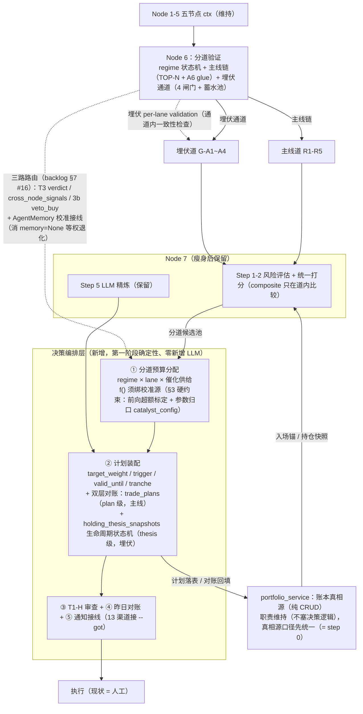

> **出处头**：三问合一裁决，2026-10-14 裁决 / 2026-10-15 修订；行号已按 2026-10-15 工作树复核（勘误见文末「行号复核勘误表」）。
> **原始稿**：[`../../GOT三问架构裁决_PLAN.md`](../../GOT三问架构裁决_PLAN.md)（291 行，裁决书正文；其顶部已加注记指向本归档稿）。
> **实施计划**：[`GOT三问架构裁决_实施计划_20261015.md`](GOT三问架构裁决_实施计划_20261015.md)（原放仓库根，2026-10-15 移入 plans/，Phase A–F 分阶段落地，非裁决正文）。
> 后续引用一律以本归档稿为准。

# GOT 三问架构裁决（got-trio-architecture-answer）

> 性质：三问合一的分析答案文档（plan mode 交付物）。证据链 =（a）4 路代码侦察 + 本人 grep/read 交叉验证、（b）docs/got 现行计划与 backlog 挂号面、（c）外网论文与行业架构对标。行号以当前工作树为准，标注 ✓ 的为本人在主会话亲自复核。

---

## 0. Context：三问与相连性

1. **Q1 埋伏/主线拆分的汇总**：拆分在 Node 2 做，Node 6 后续分析一块走；screener/Phase 2 最近拆成两支（2026-10-13 已实施）——两支的选股最后需要额外汇总吗？
2. **Q2 Node 6 仲裁**：多节点仲裁明显偏向 Node 2，仲裁缺乏效果——主线的这种仲裁方式对吗？对后拆分的埋伏板块合适吗？
3. **Q3 持仓管理与决策系统**：GOT 输出明显缺乏决策和可执行计划——决策系统是否该从 Phase 2 拆出来，挪到持仓模块做一个完整的决策 agent？

**相连性判定（本答案的总论点）**：三问同根。Q1 暴露的是"分道之后没有分道的组合构建层"，Q3 暴露的是"评分之后没有可执行的决策层"——这两个是**同一个缺失组件**（决策编排层）；Q2 暴露的"仲裁缺乏效果"根源是**仲裁输出在决策面零消费**，其修复路径（backlog §7 #16）正是把仲裁输出路由进这个新组件。三问答案因此收敛于一个目标架构补丁，而非三个平行改造。

**caveat（CPH 引用性质，O6）**：上述总论点援引的"协调断路"诊断基于综述的 Coordination Primacy Hypothesis（arxiv 2603.27539v1 §5），但 CPH 是作者自述的 **falsifiable research hypothesis**（综述 **Abstract** 逐字自述："is presented as a falsifiable research hypothesis ... rather than as an empirically validated conclusion; its definitive validation requires evaluation infrastructure that does not yet exist in the field"；§5.4 展开同一论断——五评估失败使验证前提不可得）。本答案用 CPH 作**结构性启发**（"协调接线比换更强模型重要"的问题排序），不把它当定量依据——三条问题的代码层实证（§1.1-§1.5）均独立于 CPH 成立。

---

## 1. 事实底座（代码与文档，已验证）

### 1.1 分道拆分现状

**Node 2 划分**：6 维加权埋伏评分（sector_analysis.py:2505-2517，accumulation 0.25 / RS_ratio 0.20 / RS_momentum 0.15 / turnaround 0.15 / volume_position 0.15 / strength_cap 0.10）+ 冷启动/方向/斜率三重乘性修正，`_compute_ambush_score_v2`（:2622-2703）；主线 = Track1 状态机前 16 ∪ Track2 评分 ≥0.30 前 8 真并集（`_build_mainline_output` :3316-3352）；near_miss [0.21,0.30) 最多 10（:3354-3382）。`SectorContext` 字段完全分列（active_mainline vs ambush），`theme_families` 仅聚合主线。

**screener 分道**：入口抽道 `GOT_AMBUSH_SPLIT_ENABLED` 默认 1（stock_screener.py:1996-2006 ✓）；埋伏道 `_run_ambush_lane` G-A1~A4（:1479-1626）；**D4 合并 = 主线优先追加、撞票跳过、top_n 溢出即丢**（:2248-2267）；P5 催化重排拆分后对主线池恒空不生效（:2127-2161）。分道的端到端实证 = 黄金票死于 R3 波段技术 Top15（右侧动量尺错杀左侧吸筹票），拆分正确性已有依据；但 Layer 2 影子判据（≥20 交易日 + ≥30 票 + J1' 双口径）尚在积样（2026-10-13 刚落码）。

**Node 7 组合层（隔离在漏斗里做的、在 Node 7 被部分撤销）**：
- ✓ `unified_scoring = holdings_scores + candidates_scores` 后按 `composite_score` 统一降序（portfolio_decision.py:147-148）——**混合池，无分道**；
- ✓ `_allocate` 从混合池取 buy 候选、统一 `composite_score` 降序（:4988-4993）——**无分道汇总步骤**；
- ✓ `ROLE_MULTIPLIER = {mainline:1.0, ambush:0.55, cooling:0.3, unknown:0.55}`（:44）、敞口 base actionable 主线 0.40/埋伏 0.20、caution 0.12/0.06（:411-413）；预算 = `base_budget × role_m` 等分乘数（:5076-5078）——**埋伏预算由固定折半乘数 + top_n 残位决定，不由 regime/催化供给决定**；
- 埋伏票 tech 维替换为 `ambush_rank_score×100` 仅在 `GOT_AMBUSH_SPLIT_ACTIVE=1` 生效（:4131-4137），**默认 ACTIVE=0 时埋伏票 tech 维仍是右侧动量分**；且 SCORING_WEIGHTS 两道完全相同（screener.py:132-138：资金 0.15/消息 0.15/板块 0.25/技术 0.25/风险 0.20）；
- action gate lift（priority 抬 ≥55）仍 ACTIVE 门控（:4213-4225）；bear gate 豁免 2026-10-13 转正无条件（:4280-4295）。

### 1.2 Node 6 两套仲裁结构与"偏向 Node 2"的四重证据（O1 扩充：T3 仲裁 + 3b 加权共识）

- **机制①**：`_classify_all_sectors(top_n=12)` 用 composite（Node 2 strength_lookup 基底）做 TOP-N 分类尺子（aggregator.py:1573-1578）；
- **机制②**：A6 glue 直读替换板块评分四件套（:1561-1568），但 glue 词汇经 `_GLUE_*_MAP`（:1607-1620）**最终仍映射回 Node 2 composite 尺子**；
- **机制③**：`_build_sector_intel` 展开 Node 2 MainlineGroup（:895-903），confirmed_sectors 的候选源唯一来自 Node 2。
- 埋伏通道独立于 TOP-N（入池→actionable，否则 caution，:1580-1583；`_build_ambush_channel` :2600-2703/2984，G1 利空/G2 防买顶/G3 拥挤/G4 吸筹 + 蓄水池跨日合并；`_enrich_ambush_sector_intel` :3540-3560 回写）；仓位/统一信号明确排除 ambush（:3583-3585、:3783-3789）。
- **T3**：`_detect_contradictions` 6 类矛盾（:4820-4915），家族矛盾仅主线（:4916-5012，消费 theme_families）——**埋伏无专属矛盾对**（闸门间一致性、催化供给 vs 池内天数等未建模）；`_arbitrate_contradictions`（:4650-4818）medium/high only、单次 ≤3、串行、verdict ∈ {upgrade, downgrade, keep}、**不可 exclude**、conf<0.6 忽略、dwell<2 跳过。
- `cross_node_signals`：`_detect_cross_node_temporal_signals`（:3620-3780）4 种模式，几何平均置信度；仅进 T3 prompt/监控/归档。

**仲裁结构之二：3b 分歧摘要（加权共识路径，O1 补列）**——与 T3 并列的第二套仲裁/共识机制，`src/got/disagreement.py`，经 aggregator `_build_conflict_summary_shadow`（aggregator.py:3864-3876）产出：

- `_SOURCE_PRIOR_WEIGHTS`（disagreement.py:47-54）：regime=1.5 / family_rank=1.2 / capital=1.3 / catalyst_gate=1.0 / sentiment=0.8 / sell_source=1.0——先验权重表明写偏向 Node 2（family_rank）与 Node 1 总纲（regime），是「偏向 Node 2」在**加权共识路径**上的字面证据；
- 但生产 `memory=None` → `compute_signal_weights` **退化等权**（:189-190 每项 1.0，:187 明标 TODO AgentMemory 校准）——先验表当前**不生效**；
- `build_opinions`（:128-135）：family_rank 仅 `active_mainline>0` → buy，埋伏侧无独立投票源；
- `RiskOverridePlan.veto_buy`（:79；:268-271 由 risk_override/风险否决派生 veto）：PD 侧已接线（pd.py:4966-4971，`GOT_DISAGREEMENT_ENABLED=1` 且 veto 时 buy_budget=0.0），默认影子只落 `risk_override_shadow`（schemas.py:1305-1312）；
- aggregator 侧纯观测（:3864-3876，risk_override_present 恒 False、不进判定）；`decision_path_hint`→T3 prompt 注入已存在（aggregator.py:4744-4750，enabled 时追加、空串逐字节不变）。
- 定位：先验表是「偏向 Node 2」在加权共识路径上的**第四证据**，与上述三重机制（TOP-N 尺子 / glue 回射 / 候选源唯一）并列；其消费现状分路见 §1.3 ③。

### 1.3 决策面消费缺口（"仲裁缺乏效果"的实证）

- **三路产物的消费现状（✓ 实测，O1/R3 口径）**：
  - **① T3 verdict**：`grep arbitration_verdict|arbitration_reasoning|arbitration_confidence|contradiction src/got/nodes/portfolio_decision.py` → **零命中**——T3 仲裁结果在 Node 7 决策面零消费；观测面仅归档渲染（archive.py:556-566 cross_signals 段）；
  - **② cross_node_signals**：`grep cross_node_signal src/got/nodes/` → 仅 aggregator.py 内部（检测 :3620-3780 / T3 prompt :4722 / 监控 persistence.py:794-810 / 归档），**决策面零消费**——与 backlog §1.J 四所裁"半断"（观测面三消费者 + 决策面零 grep）一致；
  - **③ 3b 分歧摘要**：`risk_override_shadow`（含 veto_buy）PD 侧已接线（pd.py:4966-4971），默认影子只观测不改 buy_budget；先验表因 memory=None 等权退化不生效（disagreement.py:189-190）；aggregator 侧纯观测（:3864-3876）。
- backlog §7 #15（industry_top 进决策面）/ #16（cross_node_signals 决策面接线，四点边界）2026-10-14 裁"待分析实施"。

### 1.4 持仓/决策现状

- **TradeAllocation 可执行要素缺失**：无 target_weight（仅绝对 target_value）、无 trigger/valid_until/order_type/tranches/execution_status；买入 `expected_return` 固定 0.10、`price_range` = est×0.98~1.02（portfolio_decision.py:5127-5131）。
- **跨日决策状态**：仅 `ambush_position_snapshots` + `holding_thesis_snapshots`；无 trade_plans/对账表，无人读昨日 portfolio_decision.json——决策每天从零生成。
- ✓ `grep "notif|send_|push" main.py:1415-1565` → **零命中**：`--got` 模式不发任何通知，13 通知渠道只接个股分析管线；用户只能从终端 print + `data/got_daily/YYYYMMDD/` 文件获结果。
- ✓ `portfolio_service.py`（1657 行）纯 CRUD/事件重放（账户/交易/现金/公司行动/FIFO/FX），**零 GOT import**，被 Node 7 单向消费（pd.py:5344-5374 快照获取，空账户兜底 10 万虚拟资金）。
- 持仓地基：holding_thesis_snapshots 1 行 / ambush_position_snapshots 0 行 → 存量持仓无入场锚（T-1 近似 HWM、T-2 生命周期断链空转）；卖出侧六条 shadow 中四条已冻结（WI-P-7），3b 已定转正门槛。

### 1.5 文档挂号面

- backlog.md **§1 row 154**：非 bear 两路合并排序待分析（2026-10-13 裁缓析）＝ Q1 正式挂号；
- backlog.md **§1.J + §7 #15/#16**（决策面接线待分析实施，2026-10-14 裁）＝ Q2 正式挂号；
- backlog.md **§1.I + 持仓模块重构文档（plans/持仓模块重构_待分析与待实施清单_20261010.md）**：持仓侧唯一归集点；§2 六问（真相源/入场锚/退出分层/出名单归属/近似纪律/可成交性）+ WI-P-7 冻结 + §6 大改返工钩子 + OPEN-1（W1-W4，W3 多账户口径是 `GOT_SELL_SOURCE_ENABLED` 转正硬前置）/OPEN-2 ＝ Q3 正式挂号；
- 埋伏分支拆分_PLAN_v2.md（已实施）：D1-D7 决策、D1' 撞票归主线、D7 bear 豁免、Layer 2 影子判据；
- architecture.md §7.6/§7.7 T3 设计意图、§9 Phase 2 五步——**无任何"决策 agent"规划痕迹**。

---

## 2. 外部证据链（论文 + 行业架构）

| 来源 | 要点 | 对应本项目的落点 |
|---|---|---|
| TradingAgents（arxiv.org/abs/2412.20138，v5） | 分析师团队 → 多空辩论 → trader 决策 → **风控团三视角再评议 → 基金经理审批**；结构化通信（NL 只用于辩论）；风控在决策之后、执行之前 | Q2：T3 受限权限（bounded authority）方向正确；Q3：决策层应有"生成→审查"分离，审查在执行前 |
| Expert Investment Teams（arxiv.org/abs/2602.23330v1） | 细粒度任务分解显著优于粗粒度角色模拟；**分析输出与下游决策偏好的对齐是性能关键驱动** | Q2：仲裁产物不被下游消费 = 对齐度为零，直接命中该论文的性能瓶颈论断；Q1：R3 右侧动量尺对埋伏票是"分析偏好与决策偏好错配" |
| LLM 金融多智能体综述（arxiv.org/pdf/2603.27539v1） | **Coordination Primacy Hypothesis**：协调设计 > 模型规模。**caveat（综述 Abstract 原文自述，§5.4 展开）**：CPH 是 falsifiable research hypothesis（分层结构证据支撑的待证假设），非实证定论；定论级验证所需评估基建该领域尚不存在 | 三问总纲（结构性启发，非定量依据）：Node 6 协调产物（T3/cross_node）无人消费是 CPH 意义上的断路——修协调的接线比换更强的模型/加更多分析更重要。代码层实证（§1.1-§1.5）独立于 CPH 成立 |
| 同综述 §4（五大评估失败） | **look-ahead bias 前视偏差 / survivorship bias 幸存者偏差 / backtesting overfitting 回测过拟合 / transaction cost neglect 交易成本忽略 / regime-shift blindness regime-shift 盲区**——五者足以反转报告收益的符号；实测案例：FinMem 报告 MSFT 累计收益 23.26%，在换用同等可辩护窗口+计入交易成本后翻转为 −22.04%（FINSABER 受控重评，arxiv 2505.07078，综述引文 [14]；FinMem 评估质量 0/5） | 本项目前向超额回测纪律的外部支撑：验证任何接线增益须防五失——样本外/防污染（对应 §3 校准源硬约束①）、按历史时点票池、多窗口滚动、净成本收益、跨 regime 覆盖；「收益符号可翻转」即总计划 §1.1 前向超额口径最坏情形的下界 |
| Self-MoA（arxiv.org/abs/2502.00674）/ MoA（2406.04692） | 单一强模型自集成常胜异质混合；单一聚合器混编异质源会劣化产出。**注（O7）：Self-MoA 论 LLM 模型集成（同源采样），类比「两道混尺=混编异质源」属从宽引；Q1 主证见 multi-strategy pod + MoE routing 行** | Q1：两道风险特征不同质（右侧动量 vs 左侧吸筹），混入单一尺子排序即"混编异质源"；Q2：per-lane validation 优于共享聚合器 |
| Du et al. debate（arxiv.org/abs/2305.14325，ICML'24） | 多视角辩论降低单视角偏差，但需可裁决的收敛机制 | Q2：T3 的 verdict 收敛机制（upgrade/downgrade/keep）是正确的受限形态 |
| FinAgent（arxiv.org/abs/2402.18485，KDD'24） | 分层记忆 + **决策-反思闭环（SIP）** + 安全决策区 | Q3：决策层成熟后的 agent 形态 = 计划 + 执行对账 + 反思记忆；"安全决策区"对应本项目确定性规则先行 |
| FinMem（arxiv.org/abs/2311.13743） | 三层记忆 + 风险偏好角色化 | Q3：跨日记忆 v2.1（persistence.py EMA 基线/跨日 ctx）已有雏形可承接反思记忆 |
| MoE routing（arxiv.org/abs/2506.14038） | 按 token/task 特征路由到不同专家，各专家用各自尺子 | Q1：汇总层应是显式路由（分道预算），不是把专家输出混成单尺 |
| Multi-strategy pod 架构（Millennium/Citadel/Point72；PODIUM/HedgeCo 行业文献） | pods 独立策略独立出票 + **中央组合构建/风险预算** | Q1：主线道/埋伏道 = 两个 pod；缺的是中央组合构建层；Moreira-Muir/Barroso-Santa-Clara 波动率管理已被 MEG 层3 引用，同源思想 |
| MSCI combining multiple alphas（2014）；CFA integrated risk budgeting multi-strategy equity；alpha risk parity（Gava 2022）；Harvey volatility targeting（Duke P135） | 多 alpha 组合构建：分源预算 + 风险预算归口，而非单一得分混排 | Q1 落地：分道预算分配的成熟方法论参照 |
| A 股实证：短期反转主导（tandfonline 10.1080/13504851.2025.2463623 连体 A/B 股；JSSMS 2024 残差收益反转；S0275531922002197 动量演化 FDA）；PEAD 存在但依赖注意力/分歧度（10.1080/1540496X.2022.2079975；JBF S1042443111000205） | A 股短周期动量弱、反转强 → 右侧动量闸门对左侧吸筹票结构性错杀；短 PEAD + 事件前吸筹流存在 → 埋伏前置设计正当 | Q1：两道风险特征不同质的本地实证基础；拆分正当性的外部支撑 |

---

## 3. Q1 裁决：拆分正确；汇总层是最薄弱环节——需要的是"组合构建层"，不是"再排一次序"

**现状判定**：拆分本身正确且有实证（黄金票死于 R3 的端到端案例；A 股反转文献支撑左侧票不该过右侧尺）。但**隔离在漏斗里做完之后，Node 7 把两道票放回同一把 composite 尺子混排**（pd.py:147-148、:4988-4993），composite 由 Node 2 strength_lookup + 右侧技术分主导——埋伏票的左侧证据链（持续吸筹/催化临近度）在 composite 里没有自己的权重承载；ACTIVE=1 的 tech 维替换只是把尺子换掉但仍同尺竞争，且默认不生效。预算侧，埋伏份额由 `top_n 残位 + 固定 0.55 乘数` 决定（D4 追加末尾、溢出即丢），而非由 regime/催化供给决定——等于埋伏道的产能取决于主线吃剩的名额。

**回答用户问题"最后需要额外汇总吗"**：**需要，但不是现在这种汇总。** D4"主线优先追加"是可接受的选股层中间态（与 top_n 语义/板块分散/T1 终审兼容）；真正缺的是它后面的**分道组合构建层**：

1. **分道预算分配**：埋伏预算占比 = f(regime, 催化供给, 蓄水池深度)，显式路由而非残位继承——bull 略偏主线、transition 适度偏埋伏、bear 仅埋伏道（D7 已转正的现状）。行业对应物 = multi-strategy pod 的中央组合构建/风险预算（MSCI multi-alpha、alpha risk parity、CFA integrated risk budgeting）。

   **校准源硬约束（O3，f() 防沦为「新 0.55 魔法乘数」）**：
   1. f(regime, 催化供给, 蓄水池深度) 的任何参数**必须先经影子期前向超额回测标定**（口径 = 总计划 §1.1：正确前向 + 减基准；基准 881100 + 中证1000，总计划 :126/:135）——任何具体实现必须先用该口径在真实票池证明 severity/预算参数对前向超额有区分度才允许接线（总计划 :166 原文纪律）；
   2. **参数归口 `catalyst_config.py`**，调参必 bump `SCORING_FORMULA_VERSION`（catalyst_config.py:370-373，meta.json 落盘、回测按版本分组）——沿用项目既有「可调参数集中管理」纪律；
   3. **未绑校准源的 f() 不接受落码**——三条均沿用既有纪律（前向超额标定 / 参数归口 / 影子先行 ≥10 交易日），无新增决策空间。
2. **composite 只在道内比较**：两道各自排各自的名，跨道只比"预算份额"不比"分数"——MoE 路由（按道选尺）与 Self-MoA（混编异质源劣化）双重支撑。
3. **撞票与风险预算归口**：撞票维持 D1'（归主线，已定）；风险预算仍归 Node 7 规则层（position_limit/敞口/止损），分道只改"买多少、买哪道"，不改"总风险多大"。
4. 影子先行：新增 trace 字段 `lane_budget_split:{mainline, ambush}` 规则层落盘，shadow ≥10 交易日；转正判据比照 J1' 双口径（lane T+3/T+5 超额）；Layer 2 积样（≥20 交易日 + ≥30 票）完成前不翻 ACTIVE，不提前。

**挂号面**：本节即 backlog §1 row 154 的裁决框架——非 bear 合并排序规则 = regime×lane 预算路由，不做单尺重排。

---

## 4. Q2 裁决：对主线是设计选择不是缺陷；对埋伏不合适；真问题是"仲裁在做无用功"

**"偏向 Node 2"属实但定性要修正**：机制清单（§1.2 的 T3 仲裁三重机制 + 3b 先验表第四证据）结构上成立，但对**主线**而言这是设计选择——Node 2 是板块候选的**唯一上游**（`_build_sector_intel` 只展开 MainlineGroup），Node 1/3/4/5 是交叉验证**证据源**而非平级候选源。主线的"仲裁"本质是**漏斗 + 交叉验证**，不是对称多源仲裁；让证据节点只能 upgrade/downgrade/keep、不能 exclude（T3 权限边界，aggregator.py:4650-4818），是 bounded authority 的正确形态。但文献援引须注明时效口径（O2）：TradingAgents 风控团有**真实 veto**、Du et al. debate 有**可裁决的收敛机制**——两者都保证输出被执行；而 T3 verdict 当前决策面零消费（§1.3 ①），无消费端的 authority 实际不存在。这两条文献只佐证**接线后的目标形态**，不背书现状。**结论：权限边界设计方向正确，但「主线仲裁方式是对的」须待接线（见下）后才成立——现状下它是在做无用功（§1.3 实证）；不必改成平权多源。**

**真问题：仲裁输出决策面零消费**（§1.3 实证）——contradictions 在 Node 7 grep 零命中、cross_node_signals 仅停留在 T3 prompt/监控/归档。这是 2602.23330 说的"分析输出与下游决策偏好对齐度 = 性能关键驱动"的对齐度零分情形，也是 CPH（2603.27539）意义上的协调断路：**检测在变强、执行端没有嘴，仲裁自然"缺乏效果"**。修复不是重构 T3，是接线（backlog §7 #16）：**三路路由进 Q3 的决策编排层**——① T3 verdict（upgrade/downgrade/keep → 预算/优先级调制）、② cross_node_signals（时序共振 → 优先级调制）、③ 3b `RiskOverridePlan.veto_buy`（PD 侧已接 pd.py:4966-4971，转正后与 ①② 并列消费；配套须做 **AgentMemory 校准接线**消除 `memory=None` 等权退化 disagreement.py:189-190，令 `_SOURCE_PRIOR_WEIGHTS` 先验生效）。

**对拆分后的埋伏板块：现仲裁不合适**，理由三点：
1. **埋伏无专属矛盾对**——6 类矛盾 + 家族矛盾全部预设针对主线（家族矛盾消费 theme_families，埋伏不参与）；"闸门间冲突"（G1-G4 互相矛盾，如 G2 防买顶 vs G4 强吸筹）、"催化取消 vs 池内天数"、"催化临近 vs 价格已抢跑"等埋伏语义矛盾未建模。
2. 埋伏已绕过 TOP-N 分类（:1580-1583），但**绕过之后没有任何替代的全局一致性检查**——它不接受主线尺子的检查，也没有自己的检查。
3. 共享 T3 的 verdict 粒度（upgrade/downgrade/keep 板块置信度）对埋伏通道无操作意义——埋伏的操作变量是"入池/蓄水/升格/退出"，不是置信度微调。

**结论**：埋伏的"仲裁"应**内化为通道内交叉验证（per-lane validation）**——在 `_build_ambush_channel` 内对 G1-G4 冲突、催化 vs 价格位置、事件状态 vs 池内天数做规则级一致性检查，产出通道内 veto/downgrade；而非挂进共享 T3。外部支撑：MoE per-token routing（按道选尺）、Self-MoA（单一聚合器混编异质源劣化——T3 恰是那个单一聚合器）。

**挂号面**：主线侧 = backlog §7 #16 接线（喂决策层）；埋伏侧 = per-lane validation 作为 §7 #16 同批新 row，影子先行。

---

## 5. Q3 裁决：决策系统该拆，但拆轴与形态要修正——先做确定性决策编排层，agent 化是后置升级

**该拆**。证据：Node 7 输出无执行语义（§1.4：无 trigger/valid_until/tranche，expected_return 固定 10%）、无跨日对账（每天从零决策）、`--got` 零通知（用户拿不到可执行计划）。TradingAgents 的 trader→风控→基金经理分离、2602.23330 的细粒度分解都支持把"决策编排"从"分析评分"里拆出来。

**但用户提议的两处修正**：

1. **"挪到持仓模块"——不能塞进 portfolio_service.py**。它是 1657 行纯 CRUD 账本、零 GOT import、被 Node 7 单向消费的**真相源**；把决策逻辑塞进去会造成账本 ↔ 决策双向耦合，破坏账本单一职责（且持仓重构文档 §2 六问中的"真相源"问题尚未收束，此时污染账本是最坏时机）。正确形态：**新建决策编排层**（消费 `portfolio_service` 账本 + GOT 5 ctx + UnifiedContext），portfolio_service **职责维持（不塞决策逻辑），但持仓真相源口径必须先统一（= step 0，W3 五处口径收束），不是"维持不动"**（O4）；持仓模块继续做账本 + 补齐入场锚/对账表等决策层地基。
2. **"完整决策 agent"（LLM 驱动）不该是第一阶段**。按项目影子先行范式（≥10 交易日）与 T1/T1-H 受限权限先例，第一阶段应是**确定性计划装配器**（零新增 LLM 调用）：
   - 补齐可执行要素：target_weight、trigger_price、valid_until、tranches、execution_status；
   - 新建 `trade_plans` 跨日对账表：计划落表 → 次日对账（执行/过期/撤销）→ 反馈进当日决策。**双层对账（O5）**：`trade_plans` 是 plan 级（执行层，主线分批为主）；埋伏多波次是 thesis 级生命周期（入场锚 → 波次推进 → 退出收口），由 `holding_thesis_snapshots` 承接——该表已有 `got_buy` 建仓写入（pd.py:2937-2952）+ `drift_watch` 漂移写入（:3189）+ `is_open` 读取（:2976-2992），缺的是完整生命周期状态机而非从零补写入；决策编排层对埋伏走 thesis 层、主线走 plan 层。thesis 层状态机定稿挂 step 0 前置（持仓重构文档 §二.2 入场锚表是其地基）；
   - **`--got` 通知接线**：13 通知渠道已存在，只差把 GOT 决策摘要接入 main.py --got 分支（main.py:1420-1563 现为零通知）；
   - LLM 只保留现有 Step 5 精炼；FinAgent/FinMem 式的反思记忆与 agent 化是决策层跑稳后的**可选升级**（升级时 LLM 仍走受限权限先例，影子 ≥10 交易日）。

**前置依赖**：决策层地基 = 持仓重构文档 §2 六问中的两项——**真相源与入场锚**（存量持仓无入场锚，T-1 近似 HWM / T-2 断链已在文档挂号）；WI-P-7 四条 shadow 已冻结，去留归大改裁决，**本答案不绕开该裁决**；OPEN-1 W3 多账户口径仍是 `GOT_SELL_SOURCE_ENABLED` 转正硬前置。

---

## 6. 统一目标架构

三问收敛后的补丁：**在漏斗与执行之间新增"决策编排层"**——它同时是 Q1 的分道组合构建、Q3 的可执行计划装配、Q2 仲裁输出的消费端。

**分工边界**：Node 7 保留风险评估/统一打分/LLM 精炼与全部风险预算（position_limit、敞口、止损、Step 1.5 超限减仓）；决策编排层接管 Step 3-4 的组合构建职责（分道预算 + 计划装配）并新增对账/通知；拆"决策编排"不拆"风险预算"——对应 pod 架构中 PM 受中枢风控约束的分工。**双层对账口径（O5）**：主线走 plan 级 `trade_plans`，埋伏走 thesis 级 `holding_thesis_snapshots` 生命周期状态机（已有 got_buy/drift_watch 写入与 is_open 读取，补的是状态机不是写入通路）；**三路路由口径（O1）**：T3 verdict + cross_node_signals 决策面零消费须接线，3b veto_buy 已接线（默认影子），三路并列进决策编排层，AgentMemory 校准接线为其配套。

---

## 7. 落地顺序（全部挂现有挂号面，不另立平行轨道）

| 序 | 动作 | 挂号面 | 范式约束 |
|---|---|---|---|
| 0 | 持仓 §2 六问收束：真相源 + 入场锚裁决（决策层地基，含 thesis 生命周期状态机定稿）；portfolio_service 真相源口径收束（W3 五处）；WI-P-7 冻结裁决不绕开 | 持仓重构文档 §2 / §6 | 裁决先行，本答案不预设结论 |
| 1 | 决策编排层 v0（确定性）：分道预算路由 + 双层对账（trade_plans plan 级 + thesis 状态机 thesis 级）+ `--got` 通知接线 + 昨日对账 | 持仓重构文档新节 + backlog §1.I 登记 | 零新增 LLM；`lane_budget_split` trace 影子 ≥10 交易日；f() 参数绑校准源（§3 硬约束）后才落码 |
| 2 | 非 bear 合并排序规则落为 regime×lane 预算路由（本文 §3） | backlog §1 row 154（裁决稿） | 影子先行；f() 参数经前向超额回测标定（总计划 §1.1 口径，881100 + 中证1000 基准）+ 归口 catalyst_config.py/bump SCORING_FORMULA_VERSION；ACTIVE 翻转等 Layer 2 积样（≥20 交易日 + ≥30 票） |
| 3 | 三路路由进决策层：① T3 verdict + ② cross_node_signals 接线（零消费→消费）+ ③ 3b veto_buy（已接线，默认影子，转正门槛 ≥10 有效样本日 archive.py:1190-1191）；配套 AgentMemory 校准接线（消 disagreement.py:189-190 等权退化，令 `_SOURCE_PRIOR_WEIGHTS` 生效） | backlog §7 #16（+ §1.J 半断收口） | 影子先行；T3 权限边界不动（仍不可 exclude）；3b 转正须 ≥10 有效样本日，且不属 WI-P-7 冻结四条 |
| 4 | 埋伏 per-lane validation（G1-G4 冲突/催化 vs 价格位置/事件取消 vs 池内天数） | backlog §7 #16 同批新 row | 影子先行 |
| 5 | （可选，成熟后）决策层 agent 化：FinAgent/FinMem 式反思记忆 | backlog §1.I 新 row | LLM 受限权限先例（T1-H 形态）+ 影子 ≥10 交易日 |

依赖关系：1 依赖 0（入场锚/真相源）；2/3/4 可在 1 的骨架内并行推进；5 依赖 1-4 稳定运行。

---

## 8. 批准后的执行段（轻量）

1. 把本答案整理为 `docs/got/plans/GOT三问架构裁决_20261014.md` 分析稿（保留全部行号引用，行号随工作树漂移需复核）；
2. backlog 登记：§1 row 154 挂裁决结论、§7 #16 挂主线侧路由 + 新增埋伏 per-lane validation row、§1.I 挂决策编排层 v0 + agent 化可选项；
3. 持仓重构文档补一节交叉引用（决策编排层依赖其 §2 六问收束）。

以上均为文档写入，无代码变更；代码实施按 §7 顺序另行立项。

## 9. Assumptions

- 影子先行 ≥10 交易日范式适用于本文所有新接线；Layer 2 判据积样完成前不翻 `GOT_AMBUSH_SPLIT_ACTIVE`。
- WI-P-7 冻结裁决、OPEN-1 W3 多账户口径等既有裁决不被本答案绕开或翻案。
- 决策编排层 v0 零新增 LLM 调用（成本不变）；agent 化（第 5 步）才涉及新 LLM 面。
- 小样本纪律：n≤2 样本不计算聚合统计；埋伏道胜率结论须等 Layer 2 判据（≥20 交易日 + ≥30 票）达标后出具。
- 外部文献要点为论文结论的转述引用（URL 已列 §2），非本项目数据验证；落地前按项目惯例先影子观测本地口径。

---

## 10. 第二意见：异议与待裁决修订（供 GLM 5.3 复核后修订正文）

> 性质：另一路复核者对 §1-§9 的**异议清单**，非改写正文。每条给「定位 / 证据 / 建议修法 / 严重度」，请逐条裁决后回写对应章节，并在本表「裁决」列填 采纳/部分采纳/驳回 + 理由。
> 引用核实（✓ 已联网复核，无需再验）：**CPH 真实**，出自 2603.27539 LLM 金融多智能体综述；**Expert Investment Teams 真实**，= 2602.23330《Toward Expert Investment Teams》(Japan Digital Design & Oxford)。§2 引用未造假。
> 复核者已确认与本文一致、且本文优于其初稿之处（不再列异议）：①汇总真正断点在 Node7 混合池（pd.py:147-148/:4988-4993）而非仅 R5；②`--got` 零通知 + TradeAllocation 缺执行要素是 Q3 硬证据；③「确定性装配器优先、agent 化后置」符合影子先行纪律。

> **裁决完成（裁决 2026-10-14，正文修订落笔 2026-10-15）**：七条已逐条裁决完毕（见 §10.0 裁决列），正文 §0–§9 已按裁决修订。§10.1/§10.5 末尾附「复核修正」段记录部分采纳条目的事实更正。

### 10.0 异议汇总表

| # | 严重度 | 定位 | 一句话 | 裁决 |
|---|---|---|---|---|
| O1 | **高（必补）** | §1.2/§1.3/§4 | 漏掉第二套仲裁机制 3b 分歧摘要（`disagreement.py`）——`_SOURCE_PRIOR_WEIGHTS` 才是「偏向 Node2」最字面证据，且 `veto_buy`/等权退化全未接 | **部分采纳**：3b 机制遗漏属实（§1.2 已补「仲裁结构之二」）；但 veto_buy 并非全未接——PD 侧已接线（pd.py:4966-4971，enabled+veto 时 buy_budget=0.0，默认影子只落 `risk_override_shadow`）；decision_path_hint→T3 注入已存在（aggregator.py:4744-4750）。真缺陷 = 先验表因 memory=None 等权退化不生效（disagreement.py:189-190，:187 TODO）+ aggregator 侧纯观测（:3864-3876）。修法照采：§1.2 增列、§4 step 3 扩三路、§7 增 AgentMemory 校准子项 |
| O2 | **高（必改）** | §4 正文结论 | 「主线仲裁方式是对的」与本文 §1.3「零消费」自相矛盾；误用 TradingAgents/Du（它们约束权限但保证执行力，T3 两者皆无） | **采纳**：自相矛盾属实（§1.3 实证零消费 vs §4 首段「是对的」）；文献误用属实（TradingAgents 风控有真实 veto、Du debate 有可裁决收敛，T3 verdict 决策面零消费 = authority 不存在）。§4 首段已改「权限边界设计方向正确但输出零消费当前完全失效，须待 step 3 接线后才成立」；文献援引已改注「佐证接线后的目标形态」 |
| O3 | 中（收紧） | §3 分道预算 `f(...)` | 预算函数缺校准源，有沦为「新 0.55 魔法乘数」风险；须绑影子期前向超额 + 参数归口 `catalyst_config.py` | **采纳**：f() 缺校准源、重蹈 0.55 覆辙风险属实。§3 已补三条硬约束（前向超额回测标定 = 总计划 §1.1 口径；参数归口 catalyst_config.py + bump SCORING_FORMULA_VERSION :370-373；未绑校准源不接受落码），与既有纪律逐条对齐，无新增决策 |
| O4 | 中（措辞） | §5 + §6 架构图 | portfolio_service「维持不动」与「真相源尚未收束（W3 5 处）」冲突；应为「职责维持、口径先统一（=step 0）」 | **采纳**：「维持不动」与 W3 5 处口径不一致冲突属实。§6 架构图 PS 节点与 §5 措辞已统一为「职责维持（不塞决策逻辑），持仓真相源口径必须先统一（= step 0）」，「维持不动」已删 |
| O5 | 中（补缺） | §5/§6 trade_plans | 埋伏多波次是 thesis 级生命周期，trade_plans 是 plan 级对账，粒度错配；须 thesis 层 + plan 层双层，埋伏在决策/持仓层同样分道 | **部分采纳**：双层分道设计点采纳（§5/§6 已补双层对账）。但证据须修正：`holding_thesis_snapshots` 已有写入通路（pd.py:2937-2952 got_buy + :3189 drift_watch + :2976 is_open 读取），缺的是 thesis 级完整生命周期写入而非「需补写入通路」从零起；v3.5 波次化是板块级先例（非持仓级现状），引用标「先例支撑思想」。thesis 层定稿挂 step 0 前置 |
| O6 | 低（严谨性） | §2 CPH 行 + §0 总纲 | CPH 被当「三问总纲」但未标注作者自述「falsifiable hypothesis, 未经实证验证」；另综述的「五大评估失败」与本项目前向超额口径更契合，宜补引 | **采纳**：已核综述原文（arxiv 2603.27539v1）：CPH 系作者自述 falsifiable hypothesis、评估基建尚不存在、非定论。§0 已加 caveat（结构性启发而非定量依据）；§2 CPH 行已加标注 + 新增五大评估失败行（look-ahead/survivorship/overfitting/cost neglect/regime-shift blindness，FinMem 23%→−22% 翻转案例）作前向超额回测纪律外部支撑 |
| O7 | 低（学术） | §2 Self-MoA/MoA 行 | Self-MoA 是 LLM 模型集成，类比「两道混尺=混编异质源」偏松；Q1 主证宜用 multi-strategy pod + MoE routing（本文已引，足够） | **采纳**：Self-MoA 论 LLM 模型集成，类比偏松属实。§2 行已注明「LLM 模型集成，类比从宽；Q1 主证见 pod + MoE routing 行」，Q1 主证已改 multi-strategy pod + MoE routing |

### 10.1 O1（高·必补）— 遗漏 3b 分歧摘要整套仲裁机制

- **定位**：§1.2「Node 6 仲裁结构」只列 T3（`_detect_contradictions`/`_arbitrate_contradictions`）+ `cross_node_signals`；§4 修复路径只路由「T3 verdict + cross_node_signals」进决策层。
- **证据（✓ 行号复核）**：Node6 另有第二套共识/仲裁机制 `src/got/disagreement.py`（3b 分歧摘要），经 `_build_conflict_summary_shadow`（aggregator.py:3864-3876）产出：
  - `_SOURCE_PRIOR_WEIGHTS`（disagreement.py:47-54）**`family_rank=1.2`（即 Node2 主线）、`regime=1.5`**——这是「偏向 Node2」最字面的证据（先验权重表明写对 Node2 加权）；
  - 但生产 `memory=None` → `compute_signal_weights`（:182-197）**退化等权（全 1.0）**，先验表根本不生效（AgentMemory 校准为 :187 明标 TODO）；
  - `build_opinions`（:128-133）`family_rank = "buy" if active_mainline>0`——Node2 主线在场即投 buy，埋伏侧无独立投票源；
  - 算出 `RiskOverridePlan.veto_buy`（:79）**但 aggregator 侧 `risk_override_present=False`（:3876）、影子态、下游零消费**。
- **后果**：①「偏向 Node2」诊断少一半证据链（选股路径之外还有加权共识路径）；②§4 接线只接半个仲裁系统——3b 加权共识、`veto_buy` 通路、`memory=None` 等权退化全被漏。
- **建议修法**：§1.2 增列 3b 机制为「仲裁结构之二」；§4 修复路径把 step 3 扩为「T3 verdict + cross_node_signals + **3b RiskOverridePlan.veto_buy** 三路路由进决策层」，并在 §7 step 3 或 step 0 增子项「**AgentMemory 校准接线**（消除 `memory=None` 等权退化，令 `_SOURCE_PRIOR_WEIGHTS` 生效）」。

- **复核修正（2026-10-14 裁决，部分采纳）**：3b 机制遗漏属实（§1.2 已增「仲裁结构之二」）。但异议两处表述须更正：① `veto_buy` 并非全未接——**PD 侧已接线**（pd.py:4966-4971，`GOT_DISAGREEMENT_ENABLED=1` 且 `RiskOverridePlan.veto_buy` 时 buy_budget=0.0；默认影子只落 `risk_override_shadow` 观测，schemas.py:1305-1312），「全未接」应更正为「**已接线但默认影子**」；② `decision_path_hint`→T3 prompt 注入**已存在**（aggregator.py:4744-4750，enabled 时追加、空串逐字节不变），并非缺失。真缺陷收窄为两点：**先验表因 memory=None 等权退化不生效**（disagreement.py:189-190，:187 明标 TODO AgentMemory 校准）+ **aggregator 侧摘要纯观测**（:3864-3876，risk_override_present 恒 False、不进判定）。修法照采：§1.2 增列、§4 step 3 扩三路、§7 增 AgentMemory 校准子项。

### 10.2 O2（高·必改）— 「主线仲裁方式是对的」是误用文献的无条件背书

- **定位**：§4 首段结论「主线仲裁方式是对的，不必改成平权多源」，援引 TradingAgents 风控团 + Du et al. debate 收敛机制佐证 T3 的 upgrade/downgrade/keep 边界。
- **矛盾**：本文 §1.3 已实证 contradictions 在 Node7 grep 零命中、cross_node_signals 仅停留 prompt/监控/归档——**输出零消费**；§4 标题亦自认「仲裁在做无用功」。正文却给主线仲裁盖「是对的」章，与自身证据冲突。
- **文献误用**：TradingAgents 风控团**有真实 veto（能拦交易）**、基金经理审批**是真实闸门**；Du et al. debate **有可裁决收敛**。它们约束的是**权限**、但保证**执行力**。而 T3（aggregator.py:4642 prompt「只允许降一级，不可直接排除」）**既不可 exclude、输出又零消费**——不是「bounded authority 做对了」，是「authority 根本不存在」。
- **建议修法**：把「主线仲裁方式是对的」改为「**主线的权限边界设计（不可 exclude）方向正确，但因输出零消费当前完全失效，须待 step 3 接线后才成立**」；TradingAgents/Du 的援引从「佐证现状正确」改为「佐证接线后的目标形态」。

### 10.3 O3（中·收紧）— 分道预算函数缺校准源

- **定位**：§3 提出埋伏预算 = `f(regime, 催化供给, 蓄水池深度)`，批评现状「固定 0.55 乘数 + top_n 残位」。
- **风险**：`f` 未给函数形态与校准方法，极易变成另一组拍脑袋硬编码系数，重蹈 0.55 覆辙。与项目既有纪律冲突：「避免多条件 AND 硬闸门，采用评分+排名截断」「权重设计实践原则」。
- **建议修法**：§3 增硬约束——「`f` 初值必须来自影子期**前向超额回测**（close[t+N]/close[t] 减基准，总计划 §1.1 口径）标定；参数集中归口 `catalyst_config.py`，不散落；未绑校准源的预算系数不接受落码」。

### 10.4 O4（中·措辞）— portfolio_service「维持不动」与真相源未收束冲突

- **定位**：§6 架构图标注 portfolio_service「账本真相源（纯 CRUD，**维持不动**）」；§5 前置依赖又承认「真相源问题尚未收束」、OPEN-1 W3 多账户口径是硬前置（5 处口径不一致）。
- **问题**：既有 5 处口径不一致，「维持不动」表述错误，会被实施者误读为「账本整块不用碰」，与 §7 step 0 打架。
- **建议修法**：架构图与 §5 措辞统一为「**职责维持（不塞决策逻辑），但持仓真相源口径必须先统一（= step 0）**」。

### 10.5 O5（中·补缺）— thesis 级生命周期 vs plan 级对账粒度错配

- **定位**：§5/§6 的 `trade_plans` 是 plan 级跨日对账（计划→次日执行/过期/撤销）；`tranches` 字段覆盖「分批」。
- **缺口**：埋伏是左侧多波次分批建仓（ambush_split_plan.md v3.5 波次化生命周期），需 **thesis 级**状态机（一个 thesis 跨多 plan/多波次/多次加仓：入场锚→加仓触发→波次推进→退出），`tranches` 未覆盖跨多日 thesis 跟踪；`holding_thesis_snapshots`（现 1 行）与 `trade_plans` 的关系未讲清。与 O1 同源——埋伏在决策/持仓层也须分道。
- **建议修法**：§5 明确双层对账——`trade_plans`（执行层，主线为主）+ `holding_thesis_snapshots`（thesis 层生命周期，埋伏为主，需补写入通路）；决策编排层对埋伏走 thesis 层、主线走 plan 层。

- **复核修正（2026-10-14 裁决，部分采纳）**：thesis/plan 双层分道设计点采纳（§5/§6 已补双层对账）。但证据两处须修正：① `holding_thesis_snapshots` **已有写入通路**——`got_buy` 建仓写入（pd.py:2937-2952，同日重跑走更新分支）+ `drift_watch` 漂移观察写入（:3180-3189 `_apply_drift_watch` 持久化）+ `is_open=True` 读取（:2976-2992 `_load_holding_theses` 每 symbol 取最新 open 记录）；缺的是 **thesis 级完整生命周期状态机**（入场锚 → 加仓触发 → 波次推进 → 退出收口），非「需补写入通路」从零起。② v3.5 波次化（ambush_split_plan.md :296 起）是**板块级**先例（`sector_analysis.py` / `node2_sector_trends` 层，判波口径 `decide_wave_days`），非持仓级现状，引用时标注「先例支撑思想」。thesis 层定稿挂 step 0 前置（持仓重构文档 §二.2 入场锚表正是其地基）。

### 10.6 O6（低·严谨性）— CPH 应标注「未经实证验证」+ 补引五大评估失败

- **定位**：§0 相连性总纲 + §2 CPH 行（2603.27539）。
- **事实（✓ 已核）**：综述作者自述「CPH is presented as a **falsifiable research hypothesis** ... rather than as an empirically validated conclusion; its definitive validation requires evaluation infrastructure that **does not yet exist**」。
- **建议修法**：CPH 引用处加 caveat「待验证假设、非定论」；同综述列的「五大评估失败（前视偏差/幸存者偏差/回测过拟合/交易成本忽略/regime-shift 盲区）」与本项目「前向超额回测口径」高度契合，宜补入 §2 作 Q1/回测纪律的外部支撑（比 CPH 更直接可用）。

### 10.7 O7（低·学术）— Self-MoA 类比偏松

- **定位**：§2 Self-MoA(2502.00674)/MoA(2406.04692) 行，用于 Q1「混编异质源劣化」。
- **问题**：Self-MoA 论的是 **LLM 模型集成**（混模型），类比「两道混入单一尺子」为 loose analogy。Q1 强支撑应是 multi-strategy pod（中央组合构建/风险预算）+ MoE routing（按道选尺），本文 §2 已引，足够。
- **建议修法**：Self-MoA 降级为辅助引用，Q1 主证改用 pod + MoE routing。

---

## 行号复核勘误表（2026-10-15 工作树实测，4 路 scout + 本轮复核）

> 纪律：行号漂移 ≤±5 行不改；>5 行或函数名错误必须勘误。以下为本次实测修正，其余行号以原文为准。

| # | 原文表述 | 实测修正 | 取证 |
|---|---|---|---|
| 1 | D4 合并 `stock_screener.py:2248-2267` | 实际 `:2244-2266`（`mainline_codes` 建集 :2250 起，撞票跳过/溢出计数 :2252-2260） | grep lane 语义 15 处命中该区间 |
| 2 | 候选源「`_build_sector_intel` 展开」 | 函数实名 `_collect_sector_candidates`（`aggregator.py:830` 起；`_build_sector_intel` 是上游消费者） | `sed -n '830,875p'` def 实测 |
| 3 | glue 词表映射行号 | `_GLUE_CAPITAL_READ_MAP` = `aggregator.py:1614`（三套词表 :1614-1629）；`_apply_glue_override_to_raw_data` = `:1645`（调用点 `:1562`） | grep 实测 |
| 4 | veto_buy 消费 `pd.py:4966-4971` | 更宽：`_dg_enabled_on` 门 `:4915`、veto 判定 `:4944-4948`、`buy_budget = 0.0` 两分支 `:4961`/`:4969`（消费块整体 `:4944-4971`） | grep 实测 |
| 5 | 「6 类矛盾」表述（§1.2/§4） | **事实修正**：`_detect_contradictions` docstring（`aggregator.py:4834`）声称 6 类，函数体实际实现 5 类——`pair=` 落点 6 处（regime_vs_sectors / tech_composite_rank_divergence / capital_vs_sentiment / regime_fresh_switch / sector_capital_mainline_mismatch / sector_capital_no_support），但第 6 类「glue 口径 vs Node 3 规则口径」**仅存在于 docstring，无 append 路径，未落码** | 全函数 `pair=` 枚举 6 处 + docstring 逐条比对 |
| 6 | 开关归属 | `GOT_DISAGREEMENT_*` / `GOT_SELL_SOURCE_*` / `GOT_MARKET_THEME_*` 均为消费点内联 `os.getenv`，不在 `catalyst_config.py`；该文件只登记 `GOT_A6_ENABLED`(`:229`) / `GOT_AMBUSH_SPLIT_ENABLED` / `GOT_AMBUSH_SPLIT_ACTIVE`(`:352-353`) | grep + `.env` 比对 |

> 本勘误表同时是实施计划 Phase F3（docstring 修正为 5 类）的取证依据；第 6 类矛盾若日后实施，登记为 backlog §7 #17（per-lane validation 同批裁决）。
